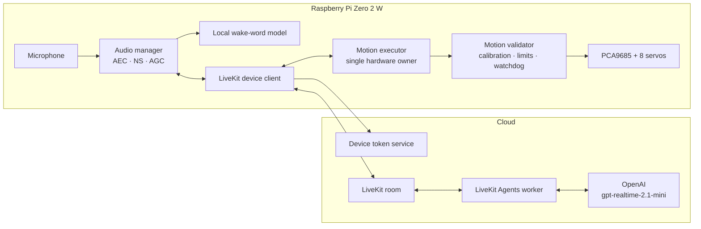
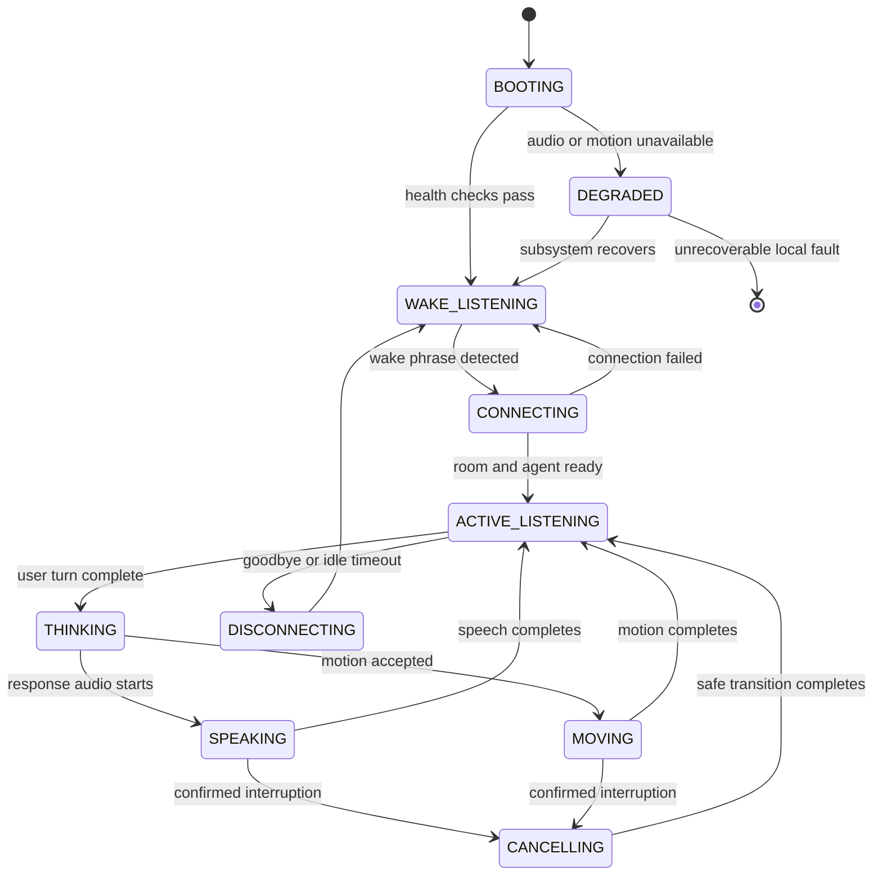
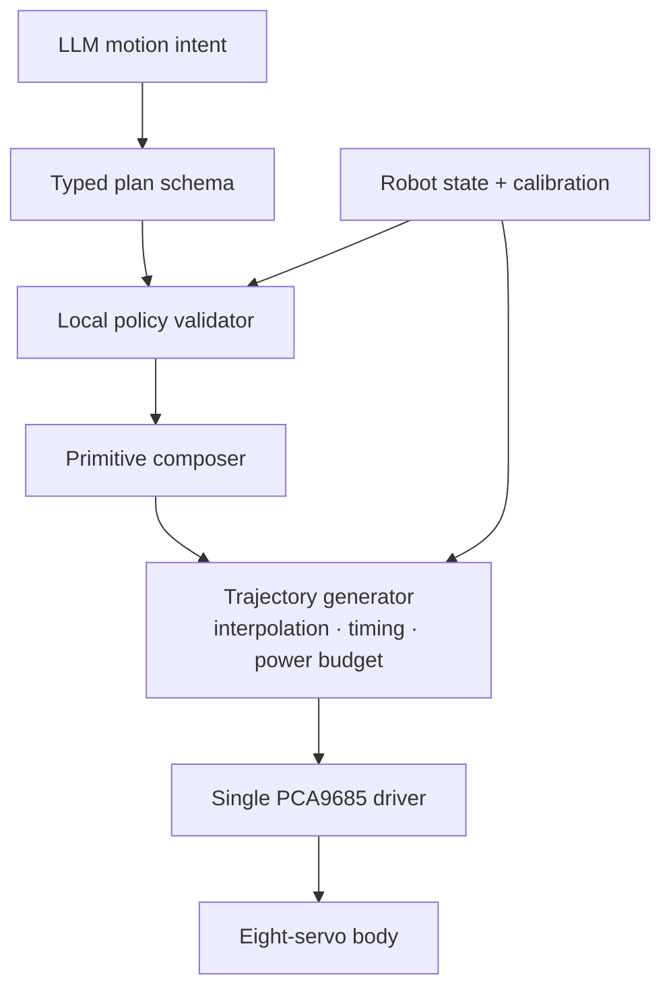

# Molty Voice Agent Technical Design

**Status:** Proposed  
**Date:** 2026-07-28  
**Scope:** Voice, session context, predefined movement, and safely composed movement  
**Target hardware:** Raspberry Pi Zero 2 W, microphone, speaker, PCA9685, eight positional servos  
**Primary implementation language:** Python  

## 1. Decision summary

Molty's first voice system should use:

- A Raspberry Pi device service for wake-word detection, audio input/output, and all servo control.
- LiveKit Cloud for room signaling and WebRTC media transport.
- A Python LiveKit Agents worker running in the cloud.
- OpenAI `gpt-realtime-2.1-mini` as the primary speech-to-speech model, with low reasoning effort.
- LiveKit RPC for typed, acknowledged commands between the cloud agent and the Pi.
- LiveKit/OpenAI conversation context that lasts only for the active session.
- Two movement paths:
  - trusted predefined actions from `hardware/sesame_actions.py`;
  - LLM-composed plans built from those trusted actions and bounded parameters.
- Local validation and execution for every movement. The model never controls PCA9685 channels directly.

The first implementation should not use Hermes, Cartesia, durable memory, a vector database, autonomous navigation, reinforcement-learning policies on the physical robot, or unrestricted LLM-generated servo angles.

## 2. Why this architecture

Molty needs to feel immediate while keeping physical control deterministic. The Pi Zero 2 W is suitable for wake-word inference, audio transport, and servo execution, but not for the main conversational model. The cloud handles language and speech; the Pi retains authority over the body.

OpenAI describes speech-to-speech sessions as the best fit for natural, low-latency interaction and interruptions. `gpt-realtime-2.1-mini` is specifically positioned as a faster, lower-cost realtime voice model with tool calling. LiveKit adds the device-oriented pieces Molty needs: rooms, audio transport, turn detection integration, interruption handling, a Raspberry Pi wake-word example, and RPC between participants.

The core architectural rule is:

> The model expresses intent. The Pi decides whether and how that intent becomes physical movement.

## 3. Product goals

### 3.1 Primary goals

- A user can say a local wake phrase and begin a natural conversation.
- Molty responds with a short, characterful voice rather than behaving like a verbose general assistant.
- The user can interrupt Molty while it is speaking.
- A confirmed interruption cancels active movement and transitions safely to a stable posture.
- Molty can execute all existing Sesame-derived actions by name.
- Molty can create varied behavior by composing safe actions and bounded parameters.
- Molty retains conversational context while the current session is active.
- The robot remains usable as a basic movement toy when the cloud agent is unavailable.
- All safety-critical decisions remain local.

### 3.2 Experience goals

- Approximately 80% pet and 20% assistant.
- Short responses, visible reactions, and small acknowledgements.
- Movement can start before a long verbal response would finish, after local acceptance.
- Idle behavior should feel alive without constantly moving or speaking.
- Molty should admit when it cannot move, cannot hear, or is offline.
- Molty should never claim that a movement succeeded before the Pi acknowledges it.

### 3.3 Non-goals for the first version

- Autonomous exploration or navigation.
- Following a person.
- Unsupervised walking near stairs, tables, or ledges.
- Raw LLM control of servo pulse widths.
- Learned physical policies on the production robot.
- Multi-user identity recognition.
- Continuous cloud streaming while dormant.
- Recording raw audio by default.
- Remembering information across sessions.
- A general-purpose agent tool ecosystem.
- A safety-rated voice emergency stop.

## 4. Current repository and hardware baseline

### 4.1 Existing physical control

`hardware/eight_servo_control.py` currently provides:

- PCA9685 initialization at 50 Hz.
- Eight logical servo names mapped to PCA9685 channels.
- Global `500–2400 µs` pulse conversion.
- Generic `0–180°` input validation.
- `stand` and `rest` poses.
- One-shot CLI execution that releases PWM afterward.

Current channel mapping:

| Logical servo | PCA9685 channel |
| --- | ---: |
| `r1` | 0 |
| `r2` | 1 |
| `l1` | 2 |
| `l2` | 3 |
| `r4` | 4 |
| `r3` | 5 |
| `l3` | 6 |
| `l4` | 7 |

### 4.2 Existing movement library

`hardware/sesame_actions.py` provides:

- Stable postures: `stand`, `rest`.
- Expressive actions: `wave`, `dance`, `swim`, `point`, `pushup`, `bow`, `cute`, `freaky`, `worm`, `shake`, `shrug`, `dead`, `crab`.
- Locomotion: `forward`, `backward`, `left`, `right`.
- Dry-run output.
- Generic angle validation.
- A `KeyboardInterrupt` path that attempts to return to `stand`.

### 4.3 Sesame anatomical mapping

The upstream Sesame top-down guide identifies the physical joints, and its motor order matches Molty's local `SERVO_CHANNELS` mapping exactly.

| Logical servo | Channel | Anatomical joint |
| --- | ---: | --- |
| `l1` | 2 | Front-left hip |
| `l3` | 6 | Front-left knee/lower-leg joint |
| `r1` | 0 | Front-right hip |
| `r3` | 5 | Front-right knee/lower-leg joint |
| `l2` | 3 | Rear-left hip |
| `l4` | 7 | Rear-left knee/lower-leg joint |
| `r2` | 1 | Rear-right hip |
| `r4` | 4 | Rear-right knee/lower-leg joint |

This resolves semantic anatomy, but it does not replace per-unit calibration. Molty's horn placement, offsets, safe endpoints, and direction must still be verified on the physical build.

### 4.4 Important limitations in the current scripts

- Actions use blocking `time.sleep` calls, so they cannot be cancelled promptly from another async event.
- The controller is created and closed per command instead of remaining available as a device service.
- PWM is released after each command, which is appropriate for a CLI but not necessarily for a persistent, expressive robot.
- Multiple actions command `0°` or `180°`. These are accepted by software but may be unsafe mechanical endpoints.
- There are no per-servo offsets, direction flags, safe limits, velocity limits, or acceleration limits.
- Partial frames assume a known previous pose.
- The anatomical mapping is inherited from Sesame rather than encoded in the local controller.
- Sequential writes with a default 20 ms delay can create visible timing skew across eight servos.
- There is no physical feedback for position, stall, current, contact, tilt, or collision.

These limitations are manageable, but they must be resolved before LLM-composed keyframes are enabled.

## 5. Confirmed decisions and remaining hardware work

The following product decisions are confirmed:

| Topic | Decision | Consequence |
| --- | --- | --- |
| LiveKit | LiveKit Cloud | Lowest operational burden for the prototype |
| Wake phrase | “Hey Molty” | Branded and short |
| Active-session timeout | 60 seconds after the last meaningful interaction | Avoids repeating the wake word while limiting cloud use |
| Owner model | One robot, one primary owner | Keeps authorization simple |
| Language | English first | Wake-word and voice tuning depend on language |
| Conversation memory | Session context only | Context is discarded when the room ends |
| Raspberry Pi OS | 64-bit | Use 64-bit-compatible Python and native audio/wake packages |
| Sensors | No IMU, distance, edge, current, or battery sensors yet | Locomotion remains supervised, explicit, and short |
| Audio | Microphone and speaker are already operational | Enumerate and record their ALSA identities during implementation |
| Locomotion | Only explicit, short commands | The robot currently has no environmental sensing |
| Dynamic movement | Primitive composition first | Safer than arbitrary keyframes |
| Cloud voice | OpenAI native realtime audio | Avoids separate STT and TTS latency |

No product decision currently blocks the vertical slice. Before physical motion is enabled, implementation still needs to record the ALSA device names, verify full-duplex audio, calibrate every servo, and establish a reliable manual way to remove servo power. A separate always-listening local “Stop Molty” classifier remains deferred.

## 6. System architecture



### 6.1 Responsibility boundaries

| Responsibility | Pi | LiveKit | OpenAI |
| --- | :---: | :---: | :---: |
| Wake-word detection | Yes | No | No |
| Microphone and speaker ownership | Yes | Media transport | Audio understanding/generation |
| Conversation orchestration | Session client | Agent session | Model behavior |
| Turn detection | Audio source | Framework integration | Semantic/server VAD |
| Barge-in handling | Cancel physical work | Stop/truncate speech | Stop current response |
| Tool selection | No | Exposes tools | Selects a tool |
| Tool authorization | Yes | Routes RPC | No |
| Servo limits and motion safety | Yes | No | No |
| Session context | No | Manages current conversation | Uses current conversation |
| API secrets | Device bootstrap only | Server credentials | Server-side key |

## 7. Framework decision

### 7.1 Selected stack

- **Edge runtime:** 64-bit Python 3.11+, `asyncio`, LiveKit Python client, `livekit-wakeword`, and the Adafruit PCA9685 library.
- **Cloud runtime:** Python 3.11+, LiveKit Agents, LiveKit OpenAI plugin.
- **Voice model:** `gpt-realtime-2.1-mini`.
- **Reasoning:** `low` initially.
- **Turn detection:** OpenAI semantic VAD with medium eagerness, tuned using real robot audio.
- **Transport:** WebRTC audio through a LiveKit room.
- **Device commands:** LiveKit RPC with versioned JSON payloads.
- **Packaging:** `uv` with separate device and agent dependency groups.
- **Process management:** `systemd` on the Pi.

### 7.2 Why LiveKit Agents

LiveKit is preferable to directly wiring the OpenAI Realtime API for this version because it already provides:

- A Raspberry Pi-oriented local wake-word pattern.
- WebRTC rooms and device audio plumbing.
- A Python agent framework.
- An OpenAI Realtime plugin.
- Interruption events and conversation-history truncation.
- RPC between the agent and the hardware participant.
- Session state and observability events.

OpenAI remains the intelligence and voice provider. LiveKit is the realtime application framework and transport.

### 7.3 Why speech-to-speech

Speech-to-speech is selected because Molty's primary experience is conversational and interruption-sensitive. It eliminates a separate STT → LLM → TTS chain and lets the model respond using audio directly.

A chained pipeline remains the fallback if:

- motion tool calls are unreliable;
- exact transcripts become a hard product requirement;
- voice consistency is insufficient;
- durable history injection causes audio-output issues;
- moderation or approval must occur between transcription and speech.

### 7.4 Model fallback strategy

1. Default: `gpt-realtime-2.1-mini`, low reasoning.
2. Quality fallback: `gpt-realtime-2.1`, low reasoning.
3. Architecture fallback: OpenAI transcription + lightweight text model + OpenAI TTS.

The model identifier must be configuration, not hardcoded across the codebase.

## 8. Runtime lifecycle

### 8.1 Device boot

1. Start the device service under `systemd`.
2. Validate the device configuration.
3. Probe the microphone, speaker, I2C bus, and PCA9685.
4. Load per-servo calibration.
5. Put the motion executor into a known safe state.
6. Load the local wake-word classifier.
7. Enter low-resource wake-listening mode.

If audio fails, motion remains available through the existing local CLI or a future local control interface. If motion hardware fails, voice may still run, but movement tools report unavailable.

### 8.2 Wake and connect

1. The local classifier detects “Hey Molty.”
2. Debounce suppresses repeated detections.
3. The Pi plays a short local activation cue.
4. The Pi requests a short-lived LiveKit token from the token service.
5. The Pi joins a uniquely named room as `molty-device:<device_id>`.
6. The cloud agent is dispatched into the room.
7. The agent calls `robot.state.v1`.
8. The agent starts an OpenAI Realtime session with a fresh conversation context.
9. Molty enters `ACTIVE_LISTENING`.

The activation cue should play before cloud audio starts, and the microphone buffer should be flushed afterward so the cue is not transcribed as user speech.

### 8.3 Active conversation

1. Audio streams from the Pi to LiveKit.
2. The realtime model identifies the user's intent.
3. For conversation-only replies, audio streams back immediately.
4. For movement, the model issues a typed function call.
5. The agent validates the function arguments structurally.
6. The agent sends a versioned RPC to the Pi.
7. The Pi validates the request against current state and safety policy.
8. The Pi immediately returns `accepted`, `rejected`, or `busy`.
9. If accepted, movement runs asynchronously and status events are emitted.
10. The model speaks only after it receives the acknowledgement.

### 8.4 Sleep

The session returns to wake-word mode when:

- the user explicitly says goodbye;
- the inactivity timeout expires;
- the network fails beyond the reconnect budget;
- the cloud agent ends the session;
- a local fault requires shutdown.

Before disconnecting, the Pi cancels movement, transitions to the configured sleep posture, and releases cloud resources. The session conversation context is discarded.

## 9. Device state machine



Speech and movement can overlap, so the implementation should maintain separate audio and motion substates even if the UI exposes one combined state.

## 10. Wake-word and audio design

### 10.1 Wake-word behavior

- Use LiveKit's client-side wake-word library.
- Validate the system first with the supplied “hey livekit” model.
- Train “Hey Molty” in the repository's Google Colab notebook only, after
  end-to-end audio works. Keep training dependencies off the Mac and Pi.
- Run inference locally at 16 kHz.
- Tune threshold using:
  - near-field speech;
  - far-field speech;
  - speaker playback;
  - servo movement noise;
  - television and music;
  - likely confusing phrases.
- Apply a debounce after activation.
- Ignore the wake phrase while a session is already active.

Suggested product metrics:

- Recall greater than 90% at normal desk distance.
- Fewer than one false activation per eight-hour day in the target room.
- Wake detection to local acknowledgement under 400 ms at P95.

These are product targets, not assumed library guarantees.

### 10.2 Microphone ownership

The wake-word listener and LiveKit room client must not fight for exclusive access to the same ALSA device.

Two viable approaches:

1. **Handoff:** stop the wake listener, release the device, then start LiveKit capture.
2. **Shared capture:** one audio manager owns the microphone and routes frames either to wake inference, LiveKit, or both.

The handoff path is simpler for the first prototype. Shared capture is preferable later if a local “Stop Molty” model must remain active during cloud sessions.

### 10.3 Echo and noise

The robot's speaker and servos are close to the microphone. The audio path therefore needs:

- acoustic echo cancellation;
- noise suppression;
- automatic gain control;
- a high-pass filter where supported;
- conservative speaker volume;
- physical microphone isolation from the servo frame;
- tests with every movement action while the agent is speaking.

Servo noise must not be treated as an interruption. Motion cancellation should be driven by LiveKit's confirmed interruption event rather than the earliest raw VAD transition, unless locomotion testing shows that the additional delay is unsafe.

### 10.4 Turn handling

Initial configuration:

- Semantic VAD.
- Medium eagerness.
- Interrupt response enabled.
- False-interruption recovery enabled during tuning.
- Maximum user-turn duration to prevent stuck sessions.
- Empty turns ignored.

When an interruption is confirmed:

1. LiveKit stops agent speech and truncates unheard conversation output.
2. The cloud agent sends `motion.cancel.v1`.
3. The Pi sets a cooperative cancellation flag.
4. The executor reaches the next cancellation point.
5. The executor follows the active primitive's validated recovery path.
6. Locomotion stops at a stable gait frame and then returns to `stand`; an expressive floor pose may recover through an intermediate pose rather than jumping directly to `stand`.

## 11. Agent design

### 11.1 Persona

The system prompt should define Molty as:

- curious, earnest, expressive, and slightly mischievous;
- concise by default;
- pet-first rather than assistant-first;
- honest about its sensors and abilities;
- willing to move when movement adds emotional meaning;
- quiet when a sound or small gesture is enough.

Suggested response policy:

- Most spoken replies: one or two short sentences.
- Avoid lists unless explicitly asked.
- Do not pretend to see, hear, remember, or move when the relevant subsystem failed.
- Do not anthropomorphize internal pain, fear, or dependency.
- Do not encourage unsafe placement or movement.

### 11.2 Tool set

Keep the first tool set intentionally small:

| Tool | Purpose |
| --- | --- |
| `get_robot_state` | Read pose, motion state, capabilities, faults, and battery if available |
| `perform_action` | Run one trusted predefined action |
| `perform_motion_plan` | Compose several trusted actions with bounded variation |
| `cancel_motion` | Stop the current action and stabilize |
| `end_session` | Say goodbye and return to wake-listening mode |

Do not expose:

- direct servo setters;
- shell commands;
- arbitrary Python execution;
- filesystem access;
- unrestricted URLs;
- raw I2C writes.

### 11.3 Tool-calling rules

- Only one motion command may be active at a time.
- Motion tools must not be called in parallel.
- The model must wait for the Pi acknowledgement before describing the result.
- A rejection must produce a truthful, short response.
- “Try again” must create a new command ID.
- Retried network deliveries with the same command ID must be idempotent.
- The model may use a small expressive action without verbal confirmation.
- Locomotion requires an explicit user request.

## 12. Motion architecture

### 12.1 Motion layers



### 12.2 Predefined actions

Existing actions become versioned primitives with metadata:

| Metadata | Example |
| --- | --- |
| Name | `wave` |
| Category | `expressive` |
| Starting pose | `stand` |
| Ending pose | `stand` |
| Nominal duration | Derived from frames |
| Risk level | `low`, `medium`, or `high` |
| Locomotion | `true` or `false` |
| Interruptible | `true` |
| Allowed intensity range | For example `0.6–1.0` |
| Allowed speed range | For example `0.75–1.25` |
| Required capabilities | Calibrated servos; future sensor requirements |

No current action should be considered safe merely because it exists in the source file. Each must pass a physical calibration and lifted-robot test.

### 12.3 LLM-composed movement

The initial dynamic system composes trusted primitives. A conceptual request is:

```json
{
  "command_id": "uuid",
  "steps": [
    {
      "primitive": "bow",
      "intensity": 0.7,
      "speed": 0.9,
      "repeat": 1,
      "pause_after_ms": 150
    },
    {
      "primitive": "wave",
      "intensity": 0.8,
      "speed": 1.1,
      "repeat": 1,
      "pause_after_ms": 0
    }
  ],
  "return_to": "stand"
}
```

Initial limits:

- Maximum 6 steps.
- Maximum total planned duration of 12 seconds.
- Maximum repeat count of 3 for expressive actions.
- Maximum locomotion cycles of 3.
- At most one locomotion primitive in a plan.
- No locomotion mixed with floor-style actions such as `dead`, `worm`, or `swim`.
- Every plan starts from or first transitions to a known pose.
- Every plan ends in `stand` unless explicitly entering `rest`.

### 12.4 Variation model

Variation should be created by:

- changing action speed within a validated range;
- scaling joint displacement around a calibrated neutral pose;
- changing repeat count;
- adding short pauses;
- selecting left/right variants where implemented;
- composing multiple primitives;
- synchronizing action start with speech state;
- choosing among equivalent acknowledgement gestures.

Random variation must use a supplied seed and be reproducible in logs.

### 12.5 Experimental generated keyframes

Raw keyframes are deferred until after primitive composition is stable.

When introduced, they must be:

- feature-flagged;
- stationary-only;
- limited to calibrated per-joint ranges;
- limited by maximum velocity and acceleration;
- checked against total duration and power budget;
- rejected if the starting pose is unknown;
- previewed in dry-run and simulation tests;
- disabled during low voltage, thermal faults, or degraded hardware state.

The LLM may propose keyframes, but the local compiler must be able to reject or modify them. Simulation approval is useful evidence but not proof of physical safety because the current MuJoCo model is approximate and is not yet calibrated against Sesame's physical joint convention.

### 12.6 Motion executor

The persistent executor should:

- exclusively own the PCA9685 device;
- track the last commanded angle for all eight joints;
- run one command at a time;
- expose cooperative cancellation checkpoints every motion frame;
- interpolate between keyframes;
- write at a controlled frame rate;
- apply a current-spike or large-delta budget;
- use action-specific recovery paths after cancellation;
- disable PWM only when intentionally resting or faulting;
- emit accepted, started, progress, completed, cancelled, rejected, and faulted statuses.

Priority order:

1. Physical stop or local fault.
2. Voice/user cancellation.
3. Explicit user locomotion.
4. Explicit expressive command.
5. Agent reactive expression.
6. Idle animation.

Higher-priority work cancels or replaces lower-priority work. Idle animations never queue behind user commands.

### 12.7 Calibration model

Each servo needs:

- PCA9685 channel;
- anatomical leg and joint;
- pulse minimum and maximum;
- safe angle minimum and maximum;
- neutral angle;
- direction sign;
- trim offset;
- maximum velocity;
- optional maximum acceleration;
- whether holding torque is required in `stand`;
- last calibration date.

Calibration must be stored outside source code in a robot-specific configuration file.

## 13. Device communication protocol

### 13.1 Identity and authorization

- Device participant: `molty-device:<device_id>`.
- Agent participant: `molty-agent:<session_id>`.
- A room is created for one active device session.
- The Pi accepts RPC only from the expected agent identity.
- The cloud agent sends commands only to the expected device identity.
- Every payload contains a schema version.

### 13.2 RPC methods

Suggested methods:

| RPC | Direction | Behavior |
| --- | --- | --- |
| `robot.state.v1` | Agent → Pi | Return a compact state snapshot |
| `motion.execute.v1` | Agent → Pi | Validate and acknowledge a motion command |
| `motion.cancel.v1` | Agent → Pi | Request cancellation and stabilization |
| `session.end.v1` | Agent → Pi | Begin graceful disconnect |

Long-running movement must not hold an RPC open for the full action. `motion.execute.v1` returns an acknowledgement quickly; completion arrives through a reliable status message or is read with `robot.state.v1`.

### 13.3 Motion acknowledgement

Conceptual response:

```json
{
  "schema_version": 1,
  "command_id": "uuid",
  "status": "accepted",
  "normalized_plan": {
    "estimated_duration_ms": 3200,
    "return_to": "stand"
  },
  "warnings": []
}
```

Possible statuses:

- `accepted`
- `duplicate`
- `busy`
- `rejected`
- `unavailable`
- `faulted`

### 13.4 Idempotency and ordering

- `command_id` is globally unique.
- The Pi stores a short rolling cache of recently handled command IDs.
- A repeated ID returns the previous acknowledgement without rerunning the action.
- Every motion status includes a monotonically increasing local sequence number.
- Commands received out of order are rejected or treated according to priority.
- A new session invalidates unfinished commands from the previous session.

## 14. Session context

### 14.1 Scope

Molty keeps context only while the current LiveKit room and OpenAI Realtime session are active. This allows follow-up questions, pronoun resolution, and references to earlier commands without adding durable storage.

The context lifecycle is:

1. Start every wake session with the fixed Molty instructions and an empty conversation.
2. Let LiveKit/OpenAI append user turns, assistant turns, and tool results.
3. Keep the context bounded by truncating older items if a session becomes unusually long.
4. Preserve tool calls and their results as matched pairs.
5. Let LiveKit truncate unheard assistant speech after interruption.
6. Discard all conversation context when the room ends.

### 14.2 Explicit behavior

- “Remember that…” can be acknowledged within the active session, but the fact is not available after sleep, disconnect, restart, or a new wake session.
- Molty must not imply that session-only context is permanent.
- No SQLite database, transcript archive, session summary, embeddings, or vector store is used.
- Raw audio and full transcripts are not persisted by Molty.
- Provider-side retention is governed separately by the configured OpenAI and LiveKit account policies.

### 14.3 Context limits

- The normal 60-second inactivity timeout naturally keeps sessions small.
- If a session is kept open manually, retain the most recent useful turns and the active motion-tool state.
- System instructions and safety constraints must never be truncated.
- A reconnect that creates a new room creates a new context; the agent should say it lost the earlier conversation if the user refers to it.

## 15. Safety model

### 15.1 Safety hierarchy

1. Physical power cut or stop control.
2. Local device watchdog and fault policy.
3. Local motion validator.
4. Voice cancellation.
5. Cloud agent instructions.

Voice cancellation is not safety-rated. Network, microphone, VAD, and model failures can prevent it from arriving.

### 15.2 Motion safety rules

- No direct channel control from the cloud.
- No movement without a known calibration.
- Reject unknown joints, actions, parameters, and schema versions.
- Reject NaN, infinity, negative durations, and oversized payloads.
- Clamp only small benign deviations; reject materially unsafe requests.
- Locomotion is bounded to short, explicit commands.
- No autonomous walking without obstacle and edge sensing.
- On room loss, cancel locomotion and stabilize locally.
- On low voltage or thermal fault, reject strenuous actions.
- On process crash, the watchdog moves to a configured fail-safe state where possible.
- A hard stop should remove servo power; software cannot replace it.

### 15.3 Current blind spots

Without additional sensors, software cannot reliably detect:

- a stalled servo;
- a trapped limb;
- a table edge;
- collision with a person or object;
- a fall in progress;
- excessive servo current;
- actual joint position;
- battery sag under load.

Until sensors exist, the robot should be treated as a supervised desk prototype.

## 16. Security and privacy

- Keep `OPENAI_API_KEY` and LiveKit API secrets in the cloud agent environment.
- Do not place provider secrets in the Pi image or repository.
- Give the Pi a device-specific bootstrap credential used only to request short-lived LiveKit tokens.
- Rotate or revoke one device without affecting all devices.
- Authorize every RPC by caller identity and room.
- Version and validate every JSON payload.
- Never expose shell or arbitrary code tools to the voice model.
- Do not record raw audio by default.
- Do not persist full transcripts in normal operation.
- Make telemetry opt-in if it leaves the owner's infrastructure.
- Disclose that the speaking voice is AI-generated.

## 17. Failure handling and edge cases

| Situation | Required behavior |
| --- | --- |
| False wake from television | Activation cue plays; session times out quickly if no real speech |
| Wake phrase missed | Stay local and continue listening; expose threshold diagnostics |
| Wake phrase repeated while active | Ignore it or treat it as normal speech, never open a second room |
| Wake listener cannot open microphone | Enter degraded state and report through local logs/status indicator |
| LiveKit capture cannot acquire microphone after wake | Release/retry the device once, then play an error cue and return to wake mode |
| Speaker missing | Continue only if configured for silent diagnostics; otherwise end the session |
| Activation chime is transcribed | Flush the capture buffer or delay stream publication |
| Speaker echo interrupts agent | Tune AEC and interruption thresholds; recover false interruptions |
| Servo noise looks like speech | Use confirmed interruption events and real-noise testing |
| User interrupts during speech only | Stop audio; no motion cancellation needed if no motion is active |
| User interrupts during motion | Cancel the action and transition to `stand` |
| User interrupts during locomotion | Stop at the earliest stable frame and transition to `stand` |
| User says “stop” before waking | Only a physical stop or separate local stop classifier can guarantee a response |
| Duplicate motion tool call | Return the cached acknowledgement; never execute twice |
| Two motion calls arrive together | Apply priority and serialize; reject or replace the lower-priority request |
| Model emits malformed motion | Reject locally and return a structured error |
| Model asks for an unknown action | Reject and provide the current capability list |
| Action exceeds duration limit | Reject or normalize only if normalization is explicitly allowed |
| Pi disconnects mid-action | Local room-loss handler cancels locomotion and stabilizes |
| Agent disconnects mid-speech | Stop output, cancel motion according to policy, return to wake mode |
| Wi-Fi flaps repeatedly | Use bounded exponential backoff; do not create a room storm |
| OpenAI rate limit or timeout | Give a local failure cue, retry within a small budget, then end gracefully |
| OpenAI audio stalls | Enforce first-audio and stream-idle timeouts |
| Tool RPC times out after acceptance | Query robot state using the command ID before retrying |
| Pi process crashes | `systemd` restarts it; hardware watchdog/fail-safe handles PWM |
| Session reconnects into a new room | Start a fresh context and do not claim to remember the earlier room |
| Context grows unexpectedly | Truncate old turns while preserving system instructions and matched tool results |
| Disk is full | Stop nonessential logs; conversation and motion must not depend on local transcript storage |
| Multiple people speak | Treat the room as single-owner; do not infer identity from voice |
| Unauthorized room participant | Ignore audio/tools and terminate the compromised session |
| Very long user monologue | Enforce a user-turn duration limit and recover politely |
| Empty or noise-only turn | Do not generate a reply |
| Unsupported language | Say so briefly or use multilingual mode only if tested |
| Robot starts in an unknown pose | Require homing/manual confirmation before motion |
| Servo command is mechanically blocked | Cannot be detected reliably without current/position sensing; stop by timeout |
| Low-voltage warning | Cancel strenuous movement and preserve enough power for shutdown |
| High Pi temperature | Reduce nonessential work; reject new motion if stability is threatened |
| Model says an action succeeded when rejected | Prompt policy and tool result must force a truthful correction |
| Session ends during a tool call | Cancel or reconcile the command locally, then discard conversation context |

## 18. Performance and resource targets

These are initial engineering targets to measure on the actual Pi and network:

| Metric | Initial target |
| --- | --- |
| Wake detection → local cue, P95 | < 400 ms |
| Wake detection → room ready, P95 | < 1.5 s |
| End of user turn → first response audio, P50 | < 800 ms |
| End of user turn → first response audio, P95 | < 1.5 s |
| In-room motion RPC acknowledgement, P95 | < 200 ms |
| Confirmed interruption → cancel signal, P95 | < 250 ms |
| Cancel signal → stable pose | < 1.0 s where mechanically possible |
| Device service idle memory | Measure; target < 180 MB |
| Sustained Pi CPU in wake mode | Measure; target < 35% total |
| False wake rate | < 1 per 8-hour day |
| Motion command duplicate rate | 0 duplicate executions |

If the Python wake-word stack exceeds the Pi budget, evaluate the Rust client while keeping the Python cloud agent and motion service.

## 19. Observability

### 19.1 Structured events

Log:

- device boot and health results;
- wake detection score and model version;
- room connection latency;
- agent/model identifiers;
- user and agent state transitions;
- first-audio latency;
- interruption and false-interruption events;
- tool name, command ID, and result status;
- motion start, completion, cancellation, rejection, and fault;
- reconnect attempts;
- CPU, memory, temperature, under-voltage, and Wi-Fi quality where available.

### 19.2 Privacy defaults

- Do not log raw audio.
- Disable full transcript logging by default.
- Permit an explicit diagnostic mode with a visible indicator and automatic expiry.

### 19.3 Correlation

Use:

- `device_id`
- `session_id`
- `room_name`
- `command_id`
- `plan_id`
- local monotonic sequence numbers

This makes interruption races and duplicate deliveries diagnosable without storing private conversation content.

## 20. Testing strategy

### 20.1 Unit tests

- Servo angle and pulse conversion.
- Calibration transform and mirroring.
- Per-joint range, velocity, and acceleration validation.
- Motion-plan schema validation.
- Plan normalization and rejection rules.
- Command idempotency.
- Cancellation at every primitive frame.
- Session-context truncation and reset.
- Session state transitions.
- RPC authorization and malformed payloads.

### 20.2 Contract tests

- Cloud tool schema matches device RPC schema.
- Every agent-visible primitive exists in the local catalog.
- All status values are handled by the agent.
- Old schema versions fail predictably.
- Retried command IDs do not execute twice.

### 20.3 Simulation and dry-run tests

- Compile every predefined action without hardware.
- Compile representative composed plans.
- Reject invalid or unsafe generated plans.
- Visualize experimental keyframes in MuJoCo only after the Sesame joint map is explicitly mapped into the simulation convention.
- Keep simulation approval separate from physical approval.

### 20.4 Hardware tests

Run in this order:

1. Servos detached from linkages where possible.
2. Robot lifted with feet clear.
3. Robot on a large floor area with a human at the power control.
4. Desk testing only after bounded locomotion is reliable.

For every action:

- verify all angles;
- verify current draw and supply stability;
- test cancellation at multiple points;
- test repeated execution;
- confirm start and end posture;
- assign a risk level;
- record the validated speed and intensity range.

### 20.5 Audio tests

- Quiet room, normal distance.
- Far-field speech.
- User speaking while Molty speaks.
- Every servo action while listening.
- Music and television.
- Multiple speakers.
- Low and high speaker volume.
- Wi-Fi congestion.
- Repeated wake/sleep cycles.

### 20.6 Conversation scenarios

- “Hey Molty, wave.”
- “Walk forward”—bounded and explicit.
- Interrupt a long response.
- Interrupt `dance`.
- Say “stop” during `forward`.
- Ask for an unavailable movement.
- Ask Molty to invent a happy reaction.
- Refer to an earlier statement within the same session.
- Start a new session and verify that the earlier statement is no longer known.
- Disconnect Wi-Fi during speech and during locomotion.
- Trigger a duplicate tool delivery.

## 21. Deployment design

### 21.1 Pi services

One device process is preferable initially:

- audio ownership;
- wake-word loop;
- LiveKit room client;
- RPC handlers;
- motion executor;
- health reporting.

Split processes only if audio/native dependency conflicts or fault isolation requires it.

Run under `systemd` with:

- restart on failure;
- bounded restart delay;
- startup after network and I2C availability;
- a dedicated Unix user;
- a writable state directory;
- environment file permissions restricted to that user;
- graceful shutdown timeout.

### 21.2 Cloud services

- Token service for short-lived device room tokens.
- LiveKit Agents worker.
- LiveKit Cloud project.
- OpenAI API project and key.
- Optional metrics sink.

The OpenAI key and LiveKit server secret remain in the cloud environment.

### 21.3 Suggested future repository layout

```text
molty.pet/
├── docs/
│   ├── voice-agent-technical-design.md
│   └── voice-agent-implementation-plan.md
├── hardware/
│   ├── eight_servo_control.py
│   └── sesame_actions.py
├── voice/
│   ├── pyproject.toml
│   ├── shared/
│   │   ├── schemas.py
│   │   └── motion_catalog.py
│   ├── device/
│   │   ├── main.py
│   │   ├── audio.py
│   │   ├── wakeword.py
│   │   ├── room_client.py
│   │   ├── motion.py
│   │   ├── calibration.py
│   │   └── health.py
│   ├── agent/
│   │   ├── main.py
│   │   ├── prompt.py
│   │   └── tools.py
│   └── tests/
├── config/
│   └── robot.example.yaml
└── systemd/
    └── molty-device.service
```

This is a target layout, not an instruction to move existing files before the vertical slice works.

## 22. Rollout gates

### Gate A: Voice-only

- Wake model runs within Pi resource limits.
- Room connects reliably.
- Full-duplex conversation works.
- User interruption stops speech.
- No servo hardware is involved.

### Gate B: One predefined action

- `wave` executes through an RPC.
- Duplicate command IDs do not execute twice.
- Interruption cancels and returns to `stand`.
- The agent reports rejection truthfully.

### Gate C: Full predefined catalog

- Every action has calibration, metadata, and a physical test record.
- Locomotion is bounded.
- Fault and disconnect behavior is verified.

### Gate D: Session context

- Follow-up questions work within one room.
- Tool calls and results remain coherent after interruption.
- A new room starts with no previous conversation.
- Raw audio and full transcripts are not retained by Molty.

### Gate E: Composed motion

- The model composes only approved primitives.
- All plans are locally validated.
- Cancellation works at every step boundary and frame.
- Plans remain within time and locomotion limits.

### Gate F: Experimental keyframes

- The documented Sesame joint map is encoded in robot calibration.
- Per-servo calibration and velocity limits exist.
- Simulation and lifted-robot validation pass.
- Feature flag defaults to off.

## 23. Rejected or deferred alternatives

### Raw OpenAI Realtime without LiveKit

Viable, but it would require Molty to implement more audio transport, device coordination, interruption plumbing, and remote command transport itself.

### Chained STT → LLM → TTS

More inspectable and deterministic, but likely less natural for the pet-first experience. Keep it as a fallback.

### Cartesia TTS

Potentially useful for later voice-character experiments. It is unnecessary while OpenAI Realtime provides audio output directly.

### Hermes

Deferred until Molty needs a broader autonomous agent tool ecosystem. The first product test should isolate voice, movement, session context, and personality.

### Durable memory or vector database

Explicitly deferred. Session context is sufficient for the first test and disappears when the room ends.

### LLM-generated raw servo stream

Rejected for the first version because network latency, model variability, missing feedback sensors, and uncalibrated physical limits make it unsafe and difficult to reproduce.

## 24. References

- [OpenAI GPT-Realtime-2.1 mini](https://developers.openai.com/api/docs/models/gpt-realtime-2.1-mini)
- [OpenAI voice-agent architecture guide](https://developers.openai.com/api/docs/guides/voice-agents)
- [OpenAI Realtime and audio guide](https://developers.openai.com/api/docs/guides/realtime)
- [LiveKit OpenAI Realtime plugin](https://docs.livekit.io/agents/models/realtime/plugins/openai/)
- [LiveKit OpenAI integration](https://docs.livekit.io/agents/integrations/openai/)
- [LiveKit wake-word guide](https://docs.livekit.io/agents/multimodality/audio/wakeword/)
- [LiveKit hello-wakeword example](https://github.com/livekit-examples/hello-wakeword)
- [LiveKit wake-word library](https://github.com/livekit/livekit-wakeword)
- [LiveKit turn and interruption handling](https://docs.livekit.io/agents/logic/turns/)
- [LiveKit chat context](https://docs.livekit.io/agents/logic/chat-context/)
- [LiveKit RPC](https://docs.livekit.io/transport/data/rpc/)
- [Sesame robot](https://github.com/dorianborian/sesame-robot)
- [Sesame build guide](https://github.com/dorianborian/sesame-robot/blob/main/docs/build-guide/README.md)
- [Sesame top-down servo map](https://github.com/dorianborian/sesame-robot/blob/main/docs/images/sesame-topdown.png)
